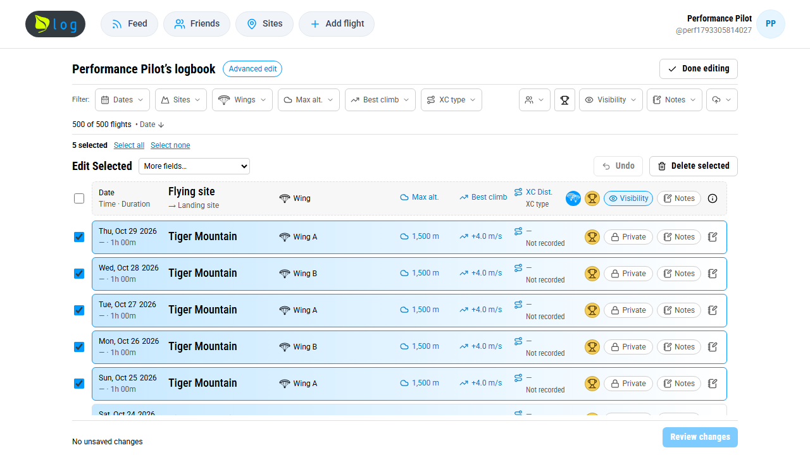
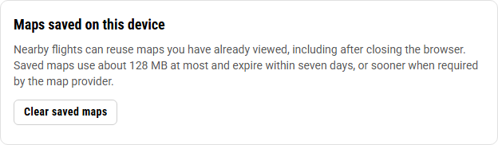

# Leaf Log performance audit — October 29, 2026

## Scope and approach

This audit follows **Find Leaf Log performance options**, including the reported
one-second selection delay and slow flight-map loading. Baseline source:
`ad33072` on `origin/main`. Production public navigation was inspected using a
fresh, signed-out Edge session. Authenticated workflows use synthetic pilots,
flights and isolated PostgreSQL schemas, never production writes.

The implementation retains the existing layout, rendering features, privacy
rules, original recordings and import/export formats. No deployment or merge
is part of this change.

## Measurements

The same production-build browser scenario creates 500 manual flights, opens
advanced editing, and measures five real checkbox clicks through two animation
frames. Windows Edge, 1280×720, no CPU/network throttling. These are comparative
local observations, not mobile-device or production latency guarantees.

| Observation | Before | After |
| --- | ---: | ---: |
| Median checkbox-to-paint time | 775.5 ms | 33.6 ms |
| Five checkbox measurements | 651.5, 775.5, 793.9, 608.1, 778.0 ms | 33.7, 36.3, 30.0, 33.5, 33.6 ms |
| Open advanced editor and expose all 500 rows, one sample | 8,553 ms | 4,749 ms |
| Selection writes to server | 0 | 0 |

Median selection feedback decreased approximately **96% (23.1× faster)**. The
opening measurement includes rendering and Playwright readiness and is a single
sample; it should not be treated as a general page-load percentile. These after
measurements include the shared date-formatter improvement. CI keeps the benchmark
attachment rather than enforcing a hardware-dependent millisecond threshold.

Screenshots were compared visually; card alignment, labels, selection borders,
filter controls and the fixed footer are unchanged. The existing responsive
browser scenario also covers desktop, narrow phones, filters, drafts, undo,
deletion review and exit protection.

The storage control was also inspected visually and browser-tested to remove
both saved map bodies and their metadata:

Raw comparative timings: [measurements.json](performance-2026-10-29/measurements.json).

A separate 5,000-label formatter comparison verified identical output and
measured median formatting time decreasing from 537.4 ms to 17.1 ms by reusing
immutable UTC date formatters. This measures date formatting only, under Node
24.21.0, rather than a whole page. See
[formatter-benchmark.json](performance-2026-10-29/formatter-benchmark.json).

## Findings and implemented improvements

| Area | Finding | Improvement |
| --- | --- | --- |
| Advanced logbook selection | Every click filtered/sorted the complete history, recalculated highlights, rebuilt every card and repeatedly formatted each card's accessible summary. | Memoized filter/sort/highlight work and flight cards; preserved unchanged flight identities; cached summaries and used sets for selection membership. Selection updates the checkbox/border/toolbar without rebuilding all metric cells. |
| Shared date labels | Date formatting created a new international formatter for each label. | Reuse two immutable UTC formatters across logbooks, headers and edit summaries. Retain each flight's UTC-offset calculation, calendar text and invalid-input behavior. |
| Replay startup | Each of three track-loading workers awaited photo metadata before publishing its track or starting the next track. | Publish each usable track immediately; separate bounded photo workers add metadata afterward. A pending photo request cannot block all tracks. |
| Replay retry | A failed photo request removed the already usable replay before retrying. | Retry photo metadata without discarding or refetching a valid track. Existing authorization-refresh and pilot-selection behavior remains covered. |
| Concurrent photo updates | Independent loading can overlap a newer photo upload/deletion refresh. | Version photo requests so a delayed initial response cannot overwrite a newer result; regression coverage explicitly resolves responses out of order. |
| Flight-site dialogs, manual entry and import review | Static imports loaded boundary/overview editor code even when its editor was not open. | Load those components on demand with React lazy loading and a sized loading placeholder. Preserve the boundary editor's imperative ref and all editing behavior. The ordinary logbook speedup comes from the rendering changes above. |
| Page/server navigation | Layout/page profile reads repeated within one server render; flight detail performed independent reads serially. | Request-scoped React memoization for identity/profile reads; parallelize authorized detail reads. No cross-request authentication cache. |
| Previous/next flight links | Navigation loaded full logbook records and resolved all their locations just to obtain IDs. | Select only flight IDs with the same ordering/status/visibility rules. Integration coverage compares owner/friend/pending/stranger/anonymous results with the original viewer-filtered lists. |
| Maps across flights/sessions | Separate maps relied on a browser HTTP cache that can evict tiles between screens or sessions; terrain responses supply no explicit cache lifetime. | Add a bounded, persistent, device-local cache for viewed public map resources and open terrain. All map instances can reuse it without changing map URLs. |
| Local storage management | No app-level way to release saved tiles. | Add **Clear saved maps** under Profile & settings. Browser storage restrictions or quota failures fall back to normal network loading. |

## Map cache design and provider constraints

The service worker intercepts only GETs to recognized public resource paths on
OpenFreeMap, MapTiler and the existing AWS Terrain Tiles endpoint. It never
caches HTML, authentication, API responses, recordings, photos, imports, exports
or flight permissions. It does not prefetch flying areas or download unseen
tiles. Provider attribution and API keys remain intact; full query strings are
part of cache keys, so different keys and provider data versions stay distinct.

- Up to 1,500 tile/font/sprite resources, at most 128 MiB of resource bodies,
  plus small metadata/header overhead; maximum individual resource 4 MiB.
- At most seven days of freshness, shortened by provider `max-age`, `Age`,
  absolute `Expires` and `Date`. Commercial responses without sufficient
  CORS-visible freshness information use normal browser HTTP caching instead.
- Never extend `no-store`, `no-cache` or `private`; reject opaque/error/range
  responses. Reload/revalidation requests retain their normal semantics.
- Openly licensed AWS terrain, which currently has no HTTP freshness policy,
  receives seven-day retention. Expired resources are not served; cleanup and
  bounded oldest-entry eviction occur opportunistically on writes/restarts.
- The original CORS Response is preserved. Separate persistent metadata records
  carry expiry and size. Reconstructing cross-origin Responses was rejected
  during real-browser testing because it broke cached fetches.
- No persistence permission prompt. Browsers may evict this optional cache,
  especially in private browsing or under storage pressure.

[OpenFreeMap](https://openfreemap.org/) allows commercial use and offline area
downloads. This implementation only caches already viewed resources.
[MapTiler's Cloud terms](https://www.maptiler.com/terms/cloud/) allow temporary
personal end-user caching and require direct provider requests; no server proxy
or shared redistribution is introduced. Its
[browser-cache guidance](https://docs.maptiler.com/guides/maps-apis/maps-platform/how-are-the-tile-requests-cached-in-web-browser/)
describes provider-controlled HTTP freshness. The
[AWS terrain dataset](https://registry.opendata.aws/terrain-tiles/) links its
[source-specific attribution/licenses](https://github.com/tilezen/joerd/blob/master/docs/attribution.md).
Existing in-map attribution is preserved.

## Workflow audit and coverage

| Pathway | Inspection / regression coverage |
| --- | --- |
| Home, sign-in, onboarding and account menu | Production home/sign-in load without page JavaScript errors; protected routes redirect to sign-in. Local signup, session choice, onboarding and sign-out browser coverage. |
| Logbook, public profiles, feed, friend links | Source review plus local viewer/relationship/privacy tests and browser navigation. Feed already paginates; no public cache is added to private records. |
| Advanced edits, sorting, filters, bulk changes | 500-flight before/after scenario plus existing responsive width sweep, draft survival, read-only recorded values, review/save/delete, undo, stale revision and exit-guard checks. |
| Flight detail, previous/next and full editor | Slim authorized ID query; detail reads run in parallel; existing editor/persistence/privacy regressions retained. |
| IGC upload and manual flight entry | Existing real upload/manual-entry browser and integration checks. Parsing, repair, deduplication, original file retention and background XC work remain unchanged. |
| CSV import, site matching and import review | Existing parsing/preview/duplicate/site-association checks; lazy site maps still use the real editor in browser tests. No change to import semantics or validation. |
| CSV export, IGC ZIP and individual IGC download | Source and integration review. Exports already stream records in 250-flight pages, respect aborts and fetch recordings individually; retain the existing bounded approach. Authorization and `private, no-store` responses remain. |
| Sites, zones, search, boundaries and community dialogs | On-demand maps; existing real geometry, rename, visibility, endorsement and authorization browser coverage. |
| Follow, Chase, Orbit and Fixed cameras | Dedicated real-renderer browser sweep selects every mode through accessible keyboard controls. Existing camera geometry/drag ownership and context-loss recovery tests remain. |
| Map, Satellite, Hybrid, Topo and Streets | Dedicated style sweep verifies controls and track survival. Test build uses a test key and deterministic provider fixtures; this does not validate paid satellite imagery content or the production account's quota. |
| MSL/AGL, playback, scrubbing, companions and photos | Existing component/integration/browser coverage plus pending-photo and photo-only retry tests. Terrain, track gaps, renderer fallback, XC overlays and profile memoization are retained. |
| Settings, ratings, devices and admin | Existing full-suite coverage; new saved-map clear control uses only device storage. No production account/device changes. |

Production public inspection covered `/`, `/sign-in`, `/logbook`, `/feed`,
`/friends`, `/sites`, `/ratings`, `/upload`, `/settings`, `/settings/import` and
`/whats-new`. Protected screens redirected as expected. Direct home/sign-in
observations were approximately 980/404 ms including browser navigation; other
requests primarily measured redirects, not authenticated workflow performance.

## Remaining opportunities and limits

- All history rows are still present in the DOM. Rendering thousands of rows can
  remain expensive on first entry; selection no longer rebuilds them. Consider
  standard pagination or list virtualization only if real larger histories
  justify its accessibility/scroll-restoration complexity.
- Full personal histories are still used to rank trophies and calculate some
  logbook summaries. Do not cache those results across users without explicit
  invalidation and privacy design.
- Styles with no verifiable persistent-cache freshness still rely on ordinary
  browser caching. Satellite access requires a configured MapTiler key; no key
  was copied out of the user's existing checkout or published.
- Changing basemaps still rebuilds terrain/custom layers as required by the
  current renderer. Camera math, terrain fidelity, GPU canary/fallback and device
  pixel ratio were kept intact; lowering visual quality without measurements
  would be premature.
- No authenticated production session, Railway/database timing access or
  physical mobile-device profiling was used. Real cellular latency, device GPU
  behavior, large paid satellite transfers and production account limits still
  need post-review field verification. No claim is made that every production
  workflow was interactively exercised.
- Mouse-only flyout automation was unstable under software WebGL: an Orbit
  choice could wait for stable frames or activate a neighboring choice while
  layout was moving. The mode matrix uses the supported keyboard path. Camera
  behavior is unchanged; pointer selection on physical devices remains a
  follow-up check, rather than a claimed resolved product defect.

## Validation record

The expanded renderer/cache matrix exceeded the original 20-minute aggregate
browser-job budget (a full 59-case Linux run took 21.4 minutes). The CI job now
allows 30 minutes for the whole browser job; individual scenario deadlines and
zero retries remain intact. The old zone test's independent flight-dialog and
standalone-management journeys are separate cases with all assertions retained.
Camera selection checks use accessible keyboard activation rather than requiring
an idle/stable hover animation or relying on coordinates during layout changes.

The final Linux application checks passed type checking, lint, all **1,036
unit/integration tests across 126 files**, and the production build (Node
24.14.0, Playwright 1.61.0, four CPUs). The final complete browser run passed
**all 61 scenarios in 19.2 minutes**, with zero failures or skips.

An earlier local run and the initial hosted CI run each passed 59/60: the combined
Orbit round trip reached the expected modes and completed rendering but exhausted
its 60-second deadline during software-GPU/driver work. Entry and exit are now
independent transition scenarios, including exit from a saved Orbit preference.
Both retain mode assertions, renderer readiness, live canvas/track checks and
page-error checks; no timeout increase or retry was added. They passed in the
full run in 48.0/41.0 seconds. Product camera behavior is unchanged. The
[draft PR's CI checks](https://github.com/adam26-ai/leaf-log/pull/114/checks)
record the complete-suite results for the submitted commit.

The checks use disposable local services and synthetic accounts. Native focused
checks, screenshot comparison, cache policy unit tests and navigation privacy
integration tests have passed. A real public OpenFreeMap tile was also read from
the persistent cache after a complete Edge restart, by both the page and a
blob-backed dedicated worker. The three client reads received the same 2,896-byte
tile through the service worker, with only one provider response overall. See
[cache-verification.json](performance-2026-10-29/cache-verification.json).
